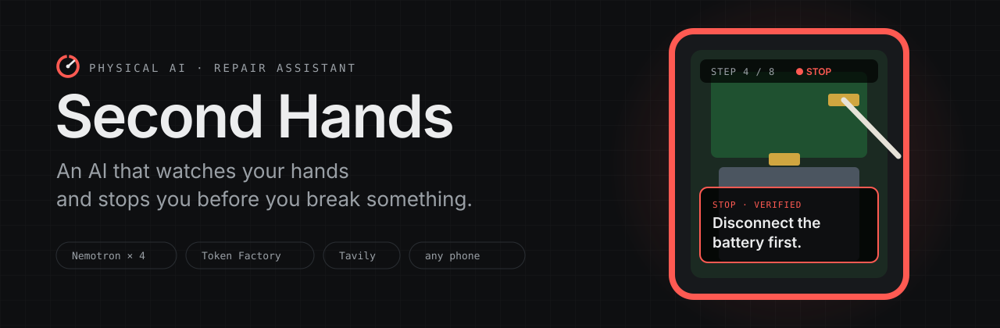
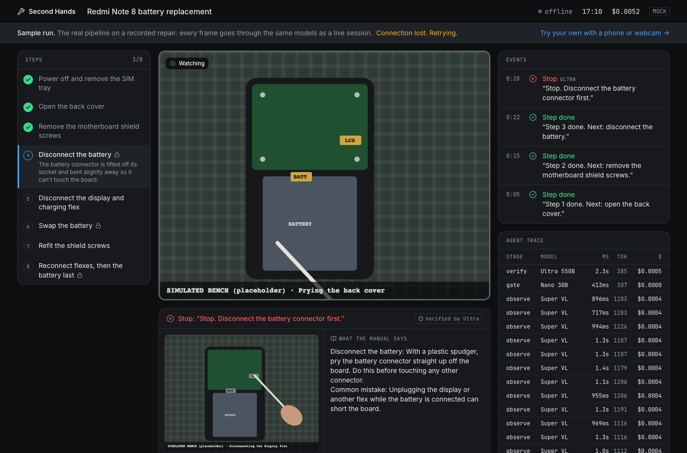

<p align="center">
  
</p>

<p align="center">
  <a href="https://second-hands-seven.vercel.app/try"></a>
  <a href="https://second-hands-seven.vercel.app"></a>
</p>

<p align="center">
  
  
  
  
  
  <a href="LICENSE"></a>
</p>

<p align="center">
  <a href="#how-it-works">How it works</a> ·
  <a href="#how-nemotron-and-token-factory-are-used">Nemotron + Token Factory</a> ·
  <a href="#how-tavily-is-used">Tavily</a> ·
  <a href="#try-it">Try it</a> ·
  <a href="#run-locally">Run locally</a>
</p>

---

Point any phone at your work: a phone repair, a cutting board, a flat-pack bookshelf. **Second Hands** finds the real guide on the web, turns it into steps a camera can check, watches every step, and speaks up only when it matters:

<p align="center"><b><i>"Stop. Disconnect the battery connector first."</i></b></p>

| 🔍 **Finds the guide** | 👁 **Watches your hands** | 🗣 **Speaks up when it matters** |
|---|---|---|
| Tavily pulls real repair guides at runtime. Nemotron Super turns them into steps a camera can verify. | Nemotron Super VL checks each frame against the manual step you're on. | Nano decides whether to interrupt. Ultra double-checks the evidence before it ever says "Stop." |

<p align="center">
  
  <br><sub>The bench dashboard mid-catch: what the AI saw next to what the manual says, verified by Ultra, with every model call in the agent trace.</sub>
</p>

## The problem

One wrong move in a repair costs real money, and nobody is watching:

- 🔋 **Unplugging the display while the battery is connected** can short the board.
- 🔩 **A long screw in a short hole** can crack the board underneath.
- 🔥 **Prying a lithium battery with metal** can start a fire.

Manuals and videos can't see what *you* are doing. An expert next to you can, but experts are expensive, and a repair shop owner can't watch every apprentice all day. **Second Hands is that expert, sitting above the bench.**

**Built for** phone repair apprentices and beginners first (shaped with input from a working phone repair shop), where one slip costs a customer's phone. The same loop works for **any hands-on task with a guide**:

| Electronics repair | Cooking | Furniture & woodwork | Home fixes | Bikes | Crafts |
|---|---|---|---|---|---|
| battery first, no metal on connectors | claw grip, cut away from your hand | panels the right way round, anti-tip strap | tap cartridges, drywall patches | flats, brakes, chains | soldering, sewing |

Tasks where a missed warning could seriously hurt someone (mains electrical, gas, vehicle brakes, firearms) are refused.

## How it works

| | Step | What happens |
|---|---|---|
| 1 | **Start** · `/start` | Pick a category and type the job (*"Redmi Note 8 battery replacement"*, *"Dice an onion safely"*). Tavily finds real guides; Nemotron builds the checklist with what "done" looks like *from above*, the costly mistakes to watch for, and where to put the camera. Edit it, then start. |
| 2 | **Pair** · `/bench` | Scan the QR code with any phone. It opens `/cam` with the rear camera. No app to install. |
| 3 | **Work** | The phone sends a frame whenever the scene changes. The dashboard shows the live view, checklist, events and an agent trace of every model call. |
| 4 | **Catch** | The same mistake in 2 of the last 3 frames → Nano decides if it's worth interrupting → on high-severity steps Ultra verifies → the phone chimes: **"Stop."** |
| 5 | **Ask** | When unsure, it asks instead: *"Is that the long screw? Hold it closer."* |
| 6 | **Override** | Tap **I'm right** and it stops warning about that on this step. |
| 7 | **Report** · `/report` | Steps done, mistakes caught, false alarms, duration, model cost, and a timeline with the frame behind every warning. |

<p align="center">
  
</p>

## How Nemotron and Token Factory are used

Every model call runs through **Nebius Token Factory** at runtime ([`lib/ai/client.ts`](lib/ai/client.ts)). Four **NVIDIA Nemotron** models each get one job, sized to it:

| Role | Model | Job | Why this size |
|---|---|---|---|
| 👁 **Eyes** | `Nemotron-3.5-Super-VL` | Each frame + the current manual step → structured observation: step state, possible mistake, confidence, evidence | The NVIDIA vision model on Token Factory, strong enough to read small parts on a board |
| ⚡ **Gatekeeper** | `Nemotron-3-Nano-30B-A3B` | *Warn / ask / stay silent*, and writes the ≤15-word spoken line | Runs on every confirmed candidate, so it has to be fast and cheap. Reasoning off. |
| 🧭 **Planner** | `nemotron-3-super-120b-a12b` | Tavily-fetched guide → camera-checkable steps; end-of-session summary | Long-context reading and careful structure, once or twice per session |
| ⚖️ **Judge** | `Nemotron-3-Ultra-550b-a55b` | Verifies high-severity warnings across recent frames before any "Stop" | A false stop kills trust, a missed one kills a device. The biggest model, reasoning on, for this call only. |

**What keeps it accurate and cheap:**

- **Confirmation is code, not a model.** A mistake must show in 2 of the last 3 frames, isn't repeated within 25 s, and is silenced by an override ([`confirm.ts`](lib/pipeline/confirm.ts), unit-tested).
- **No invented alarms.** The vision model can only flag mistake types the manual lists.
- **Ultra only when it matters.** High-severity steps only. If it doesn't confirm, the warning becomes a question.
- **Validated output.** Every model response is checked with zod, retried once, then falls back safely.
- **Frames only on change.** A 32×32 change detector plus a heartbeat, with one request in flight.
- **Full transparency.** Every call is traced (stage, model, latency, tokens, $) live on the dashboard and in the report.

> **Measured latency and cost:** pending the real-model evaluation. This section will show measured numbers only; nothing here is estimated.

## How Tavily is used

Tavily is the product's source of truth, not decoration. At runtime, `/api/guide` calls **Tavily Search** (`search_depth: advanced`) to find real repair guides for the exact device and job, then **Tavily Extract** to pull the full text of the top results. Nemotron turns that text into the checklist, and the source links are shown before you start ([`lib/tavily.ts`](lib/tavily.ts), [`lib/pipeline/guide.ts`](lib/pipeline/guide.ts)). Hand-checked guides for the demo devices are only a fallback if search fails.

## Try it

| | |
|---|---|
| ▶ **No setup** | Open **[/try](https://second-hands-seven.vercel.app/try)** and press *Run the sample*: the same pipeline on a sample clip, ending in a report. If the day's demo budget is used up, it plays a clearly labelled recorded run. |
| 📱 **With a phone** | Open **[/start](https://second-hands-seven.vercel.app/start)** on a laptop, pick an example, start the session, and scan the QR code. |

No login anywhere.

## Run locally

```bash
pnpm install
cp .env.example .env.local   # leave the keys empty to run in mock mode
pnpm dev                     # http://localhost:3000
```

<details>
<summary><b>Environment variables</b></summary>

| Variable | Needed for |
|---|---|
| `TOKEN_FACTORY_API_KEY` | Real Nemotron models. Without it, every model call returns scripted fixtures with the same shapes (mock mode). |
| `TAVILY_API_KEY` | Live guide search. Without it, the built-in guides are used. |
| `UPSTASH_REDIS_REST_URL` / `_TOKEN` (or Vercel's `KV_REST_API_*`) | Shared state when deployed. Without it, an in-memory store is used (local only). |
| `DAILY_BUDGET_USD` | Daily Token Factory spend cap for the public demo (default 1.5). |
| `MODEL_*` | Override any model ID. |

</details>

<details>
<summary><b>Testing with a phone on the same Wi-Fi</b></summary>

Phone cameras need HTTPS, so create a local certificate that covers your LAN IP:

```bash
mkdir -p certificates
openssl req -x509 -newkey rsa:2048 -nodes -days 30 \
  -keyout certificates/dev-key.pem -out certificates/dev-cert.pem \
  -subj "/CN=second-hands-dev" \
  -addext "subjectAltName=DNS:localhost,IP:127.0.0.1,IP:$(ipconfig getifaddr en0)"
pnpm dev:https
```

Open `https://<your-LAN-IP>:3000/start` on the laptop, accept the certificate warning on both devices, and scan the QR code.

</details>

<details>
<summary><b>Project layout</b></summary>

```
app/            pages (/, /start, /bench, /cam, /try, /report) and API routes
lib/ai/         Token Factory client, model config, prompts
lib/pipeline/   guide · observe · confirm · gate · verify · frame · report
lib/capture/    camera, frame capture + change detector, voice, placeholder clip
lib/mock/       scripted model outputs and hand-checked guides
components/     dashboard pieces: checklist, evidence, events, agent trace
```

</details>

`pnpm test` runs the unit tests · `pnpm build` makes a production build.

## Safety and limitations

- **Guidance only.** You are responsible for your repair. Not for mains electrical work.
- In the demo, the battery is only disconnected, never pried or punctured.
- A camera can't verify fine soldering or micro-components, so steps it can't check are skipped unless they're safety-critical.
- The public demo is rate-limited (per IP, a daily budget, a 5-minute cap per live session) so it stays up for judging.

---

<p align="center">
  <sub>Built for the <b>Nebius × NVIDIA Global AI Hackathon</b> · Physical AI track · <a href="LICENSE">MIT License</a></sub>
</p>
