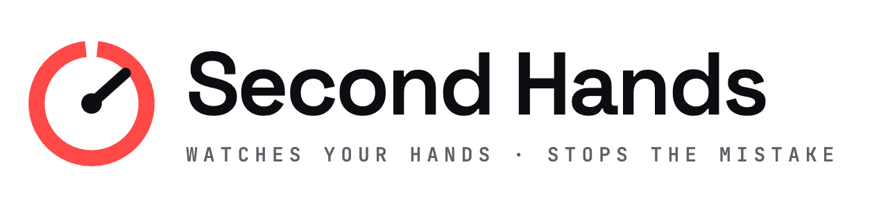
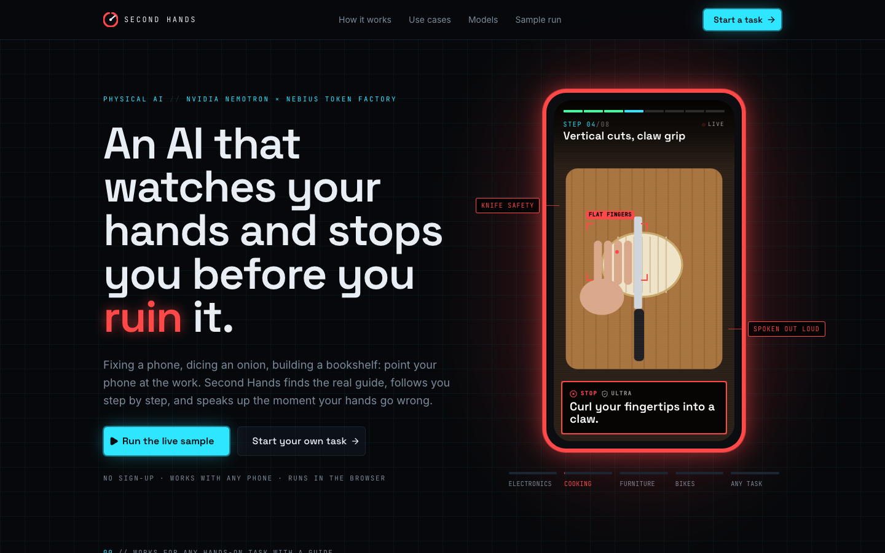
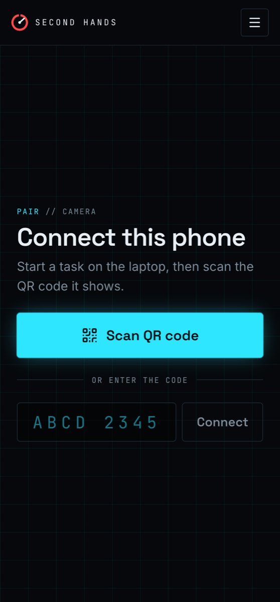
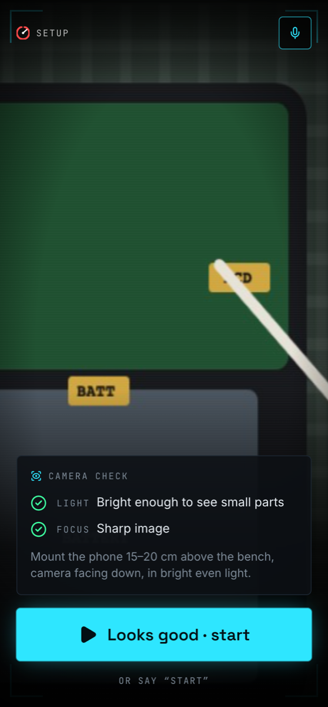
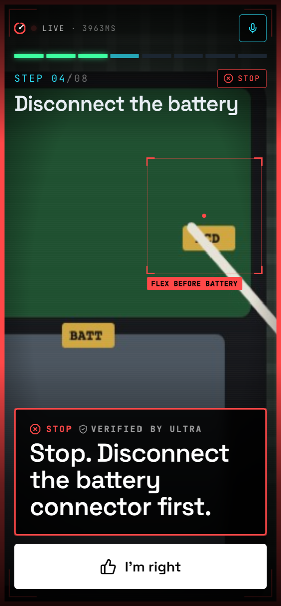
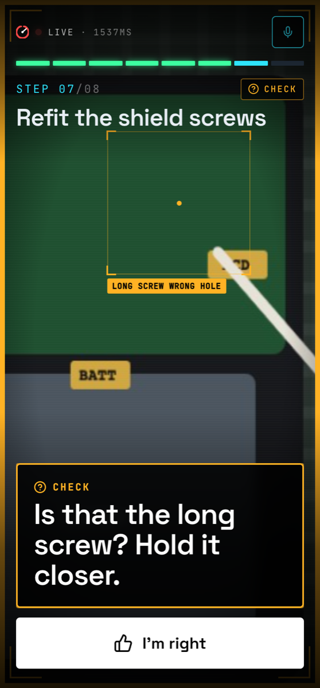
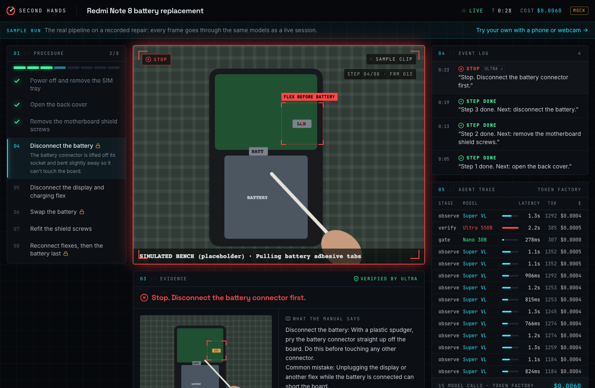
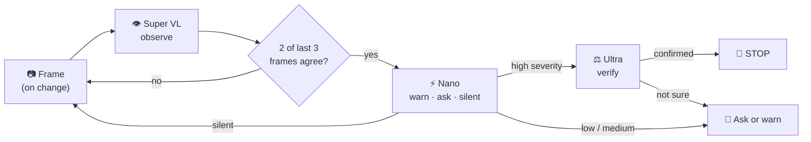
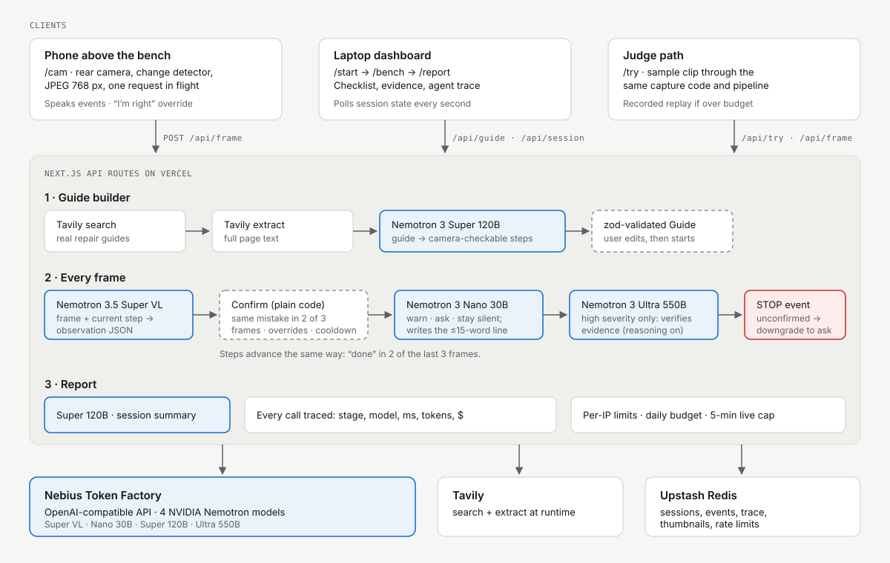
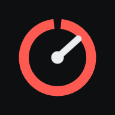

<p align="center">
  <picture>
    <source media="(prefers-color-scheme: dark)" srcset="docs/logo-dark.png">
    
  </picture>
</p>

<h3 align="center">An AI that watches your hands while you repair, build or cook,<br>and stops you before you ruin it.</h3>

<p align="center">
  <a href="https://second-hands-seven.vercel.app/try"></a>
  <a href="https://second-hands-seven.vercel.app"></a>
  <a href="https://second-hands-seven.vercel.app/cam"></a>
</p>

<p align="center">
  
  
  
  
  
  <a href="LICENSE"></a>
</p>

<p align="center">
  <a href="#-see-it-work">See it work</a> ·
  <a href="#-how-it-works">How it works</a> ·
  <a href="#-works-on-any-device">Devices</a> ·
  <a href="#-how-nemotron-and-token-factory-are-used">Nemotron + Token Factory</a> ·
  <a href="#-how-tavily-is-used">Tavily</a> ·
  <a href="#-roadmap">Roadmap</a> ·
  <a href="#-run-locally">Run locally</a>
</p>

<p align="center">
  
</p>

---

Mount any phone above your work: a phone repair, a cutting board, a flat-pack bookshelf. **Second Hands** finds the real guide on the web, turns it into steps a camera can check, watches every step, and speaks up only when it matters:

<p align="center"><b><i>"Stop. Disconnect the battery connector first."</i></b></p>

| 🔍 **Finds the guide** | 👁 **Watches your hands** | 🗣 **Speaks up when it matters** |
|:---|:---|:---|
| Tavily pulls real guides at runtime. Nemotron Super turns them into steps a camera can verify. | Nemotron Super VL checks each frame against the step you're on and boxes what it's looking at. | Nano decides whether to interrupt. Ultra double-checks the evidence before it ever says "Stop." |

<table>
  <tr>
    <td align="center" width="25%"><h3>4</h3><sub>NVIDIA Nemotron models,<br>one job each</sub></td>
    <td align="center" width="25%"><h3>~1 s</h3><sub>for Super VL<br>to read a frame</sub></td>
    <td align="center" width="25%"><h3>2.8 s</h3><sub>for the frame that turned a staged<br>mistake into a verified STOP</sub></td>
    <td align="center" width="25%"><h3>≤ $0.20</h3><sub>in model calls for a<br>10-minute session</sub></td>
  </tr>
</table>
<p align="center"><sub>Measured on Nebius Token Factory, Oct 26 2026 (Phase 0 smoke test). Details <a href="#-how-nemotron-and-token-factory-are-used">below</a>.</sub></p>

## 📸 See it work

<table>
  <tr>
    <td align="center" width="25%"><br><sub><b>1 · Pair</b><br>Scan the QR on the laptop</sub></td>
    <td align="center" width="25%"><br><sub><b>2 · Camera check</b><br>Light and focus, flashlight</sub></td>
    <td align="center" width="25%"><br><sub><b>3 · Stop</b><br>Verified by Nemotron Ultra</sub></td>
    <td align="center" width="25%"><br><sub><b>4 · Ask</b><br>Unsure? It asks. "I'm right" overrides.</sub></td>
  </tr>
</table>

<p align="center">
  
  <br><sub>The bench dashboard mid-catch: what the AI saw next to what the manual says, verified by Ultra, with every Token Factory call in the agent trace.</sub>
</p>

## 🧩 The problem

One wrong move in a hands-on job costs real money, or a finger, and nobody is watching:

- 🔋 **Unplugging a phone's display while the battery is connected** can short the board.
- 🔩 **A long screw in a short hole** can crack the board underneath.
- 🔪 **Flat fingers in front of a knife** is how most kitchen cuts happen.
- 🪚 **A bookshelf without its anti-tip strap** can fall on a child.

Manuals and videos can't see what *you* are doing. An expert next to you can, but experts are expensive, and a repair shop owner can't watch every apprentice all day. **Second Hands is that expert, sitting above the bench.**

**Built for** phone repair apprentices first (shaped with input from a working phone repair shop), where one slip costs a customer's phone. The same loop works for any hands-on task with a guide:

| 🔌 Electronics | 🍳 Cooking | 🪚 Furniture | 🏠 Home fixes | 🚲 Bikes | ✂️ Crafts |
|:---:|:---:|:---:|:---:|:---:|:---:|
| battery first, no metal on connectors | claw grip, cut away from your hand | panels the right way round, anti-tip strap | tap cartridges, drywall patches | flats, brakes, chains | soldering, sewing |

Tasks where a missed warning could seriously hurt someone (mains electrical, gas, vehicle brakes, firearms) are refused.

## ✨ What's in the box

**📱 The phone app** (installable, no app store)
- Full-screen HUD over the live camera: segmented step bar, scan line, and a **focus box** drawn from the vision model's output
- **Pair in a second:** scan the laptop's QR (native `BarcodeDetector`, jsQR fallback) or type the 8-character code
- **Camera check** before starting (light, focus) and a **flashlight** toggle (Android)
- **Hands-free voice commands:** *"skip"*, *"back"*, *"repeat"*, *"check"*, *"I'm right"*, *"pause"*. It never reacts to its own voice.
- **Manual controls:** Back · Check now · Skip · Pause, so the person stays in charge
- Spoken warnings with a chime before every *Stop*; the screen stays awake

**💻 The bench dashboard**
- Procedure checklist, **live view about 1 s behind the camera** (a small preview stream that never touches a model), **evidence panel** (the frame next to the manual step), console-style event log
- **Agent trace:** every Token Factory call with stage, model, latency, tokens and cost
- **Session report:** steps done, mistakes caught, false alarms, duration, cost, and a timeline with the frame behind every warning

**🧪 Built to be judged**
- [`/try`](https://second-hands-seven.vercel.app/try): one click, no camera needed. It plays a clearly labelled recorded run while the real-footage sample clip is being recorded, then runs the live pipeline on that clip (with the replay as a fallback if the daily demo budget is used up)
- Per-IP limits, a daily budget cap and a 5-minute cap per live session keep the public demo up through judging

## ⚙️ How it works

| | Step | What happens |
|:-:|---|---|
| 1 | **Start** · `/start` | Pick a category and type the job (*"Redmi Note 8 battery replacement"*, *"Dice an onion safely"*). Tavily finds real guides; Nemotron builds the checklist with what "done" looks like *from above*, the costly mistakes to watch for, and where to put the camera. |
| 2 | **Pair** · `/cam` | Scan the QR with any phone (or install the app). Camera check, then it starts watching. |
| 3 | **Watch** | The phone sends a frame whenever the scene changes. The dashboard shows the live view, checklist, events and every model call. |
| 4 | **Catch** | The same mistake in 2 of the last 3 frames → Nano decides if it's worth interrupting → on high-severity steps Ultra verifies → the phone chimes: **"Stop."** |
| 5 | **Ask** | When unsure, it asks instead: *"Is that the long screw? Hold it closer."* **I'm right** silences it for that step. |
| 6 | **Report** · `/report` | Steps done, mistakes caught, false alarms, duration, cost, and the evidence timeline. |

**The catch loop**, from frame to spoken warning:



<p align="center">
  
</p>

## 📱 Works on any device

Everything runs in the browser over the internet, so the camera and the dashboard don't need to share a Wi-Fi network, and nothing is installed from an app store.

| Camera | Dashboard | |
|---|---|---|
| Android phone (Chrome) | Laptop / PC, or another phone | ✅ Tested on a Poco F1 and a Moto G85 |
| iPhone (Safari) | Laptop / PC, or another phone | ✅ Tested in WebKit with iPhone 15 emulation: QR pairing, frames, live view |
| Laptop webcam | The same laptop | ✅ Point the webcam at your hands |
| No camera | Any browser | ✅ [`/try`](https://second-hands-seven.vercel.app/try) sample run |

On iPhone, add it with Share → *Add to Home Screen*. Safari doesn't let web apps control the flashlight, and voice commands depend on the iOS version; the on-screen buttons always work.

## 🧠 How Nemotron and Token Factory are used

Every model call runs through **Nebius Token Factory** at runtime ([`lib/ai/client.ts`](lib/ai/client.ts)). Four **NVIDIA Nemotron** models each get one job, sized to it:

| Role | Model | Job | Why this size |
|---|---|---|---|
| 👁 **Eyes** | `Nemotron-3.5-Super-VL` | Each frame + the current manual step → structured observation: step state, possible mistake, confidence, evidence, and a focus box | The NVIDIA vision model on Token Factory, strong enough to read small parts on a board |
| ⚡ **Gatekeeper** | `Nemotron-3-Nano-30B-A3B` | *Warn / ask / stay silent*, and writes the ≤15-word spoken line | Runs on every confirmed candidate, so it has to be fast and cheap. Reasoning off. |
| 🧭 **Planner** | `nemotron-3-super-120b-a12b` | Tavily-fetched guide → camera-checkable steps, camera setup tip, safety refusals; end-of-session summary | Long-context reading and careful structure, once or twice per session |
| ⚖️ **Judge** | `Nemotron-3-Ultra-550b-a55b` | Reasons over Super VL's observations from recent frames (text, not pixels) and confirms a high-severity warning before any "Stop" | A false stop kills trust, a missed one breaks a device or a finger. The biggest model, reasoning on, for this call only. |

**What keeps it accurate and cheap:**
- **Confirmation is code, not a model.** A mistake must show in 2 of the last 3 frames, isn't repeated within 25 s, and is silenced by an override ([`confirm.ts`](lib/pipeline/confirm.ts), unit-tested).
- **No invented alarms.** The vision model can only flag mistake types the guide lists.
- **Ultra only when it matters.** High-severity steps only; if it doesn't confirm, the warning becomes a question.
- **Validated output.** Every model response is checked with zod, retried once, then falls back safely.
- **Frames only on change.** A 32×32 change detector plus a heartbeat, one request in flight, never faster than one frame per 1.6 s.
- **Thinking only where it pays.** Nemotron reasons by default; Eyes, Gatekeeper and Planner run with `enable_thinking: false` for speed. Only the Judge thinks.
- **Full transparency.** Every call is traced (stage, model, latency, tokens, $) live on the dashboard and in the report.

**Measured on Token Factory** (Phase 0 smoke test, Oct 26 2026; single runs, so treat as indicative):

| Call | Model | Latency | Cost |
|---|---|---|---|
| Observe one 768 px frame (~1.2K input tokens) | Super VL | 0.8–1.4 s | $0.0005 |
| Gate a candidate warning | Nano 30B | ~0.4 s | <$0.0001 |
| Verify a STOP (reasoning on) | Ultra 550B | ~1.1 s | ~$0.001 |
| Build a guide (Tavily search + extract + planner) | Super 120B | 20–22 s end to end | ~$0.003 |

A staged "display flex unplugged while the battery is connected" was flagged on the first frame and became an Ultra-verified **STOP** on the second (2.8 s for that frame). At the frame-rate cap, a 10-minute session costs at most ~$0.20 in model calls.

> **Catch rate and false alarms:** pending the eval on recorded real repairs. Only measured numbers will go here.

## 🔎 How Tavily is used

Tavily is the product's source of truth, not decoration. At runtime, `/api/guide` calls **Tavily Search** (`search_depth: advanced`) for real guides for the exact device and job, then **Tavily Extract** for the full text of the top results. Nemotron turns that text into the checklist, and the source links are shown before you start ([`lib/tavily.ts`](lib/tavily.ts), [`lib/pipeline/guide.ts`](lib/pipeline/guide.ts)). Video and social results (no step text) are excluded. If Tavily is unavailable, the planner works from well-known safe practice, and hand-checked guides for the demo tasks are the last fallback.

## 🚀 Try it

| | |
|---|---|
| ▶ **No setup** | Open **[/try](https://second-hands-seven.vercel.app/try)** and press *Run the sample*: the same pipeline on a sample clip, ending in a report. |
| 📱 **With a phone** | Open **[/start](https://second-hands-seven.vercel.app/start)** on a laptop, pick a task, start the session, and scan the QR with the phone. Install the phone app from **[/cam](https://second-hands-seven.vercel.app/cam)** (Android: *Install*; iPhone: *Add to Home Screen*). |

No login anywhere.

## 🗺 Roadmap

<table>
  <tr>
    <th width="33%">✅ Shipped</th>
    <th width="33%">🔜 Next · Nov–Dec 2026</th>
    <th width="34%">🧭 2027</th>
  </tr>
  <tr valign="top">
    <td>
      • Live on real Nemotron models via Token Factory<br>
      • Guide builder with Tavily + Nemotron<br>
      • Live frame loop: Super VL → 2-of-3 confirm → Nano → Ultra<br>
      • Phone HUD with focus box and spoken warnings<br>
      • Installable phone app, QR pairing<br>
      • Voice commands, flashlight, camera check<br>
      • Manual Back / Check / Skip<br>
      • 6 task categories + safety refusals<br>
      • Bench dashboard, agent trace, session report<br>
      • Live view ~1 s behind the camera<br>
      • Android, iPhone and PC, any pairing<br>
      • Security hardening: input limits, rate limits, headers<br>
      • Zero-setup <code>/try</code> with replay fallback
    </td>
    <td>
      • <b>Measured eval</b>: catch rate, false alarms, latency and cost on real repairs, published here<br>
      • <b>Hindi and multilingual voice</b>: warnings translated by Nemotron for repair shops in India and beyond<br>
      • <b>Phone-only mode</b>: pick a task and start watching with no laptop<br>
      • <b>Highlight clips</b>: a short video of every catch in the report<br>
      • <b>Shop mode</b>: one owner, many benches on one dashboard
    </td>
    <td>
      • <b>On-device vision</b> on Jetson-class edge hardware for sub-second warnings and offline benches<br>
      • <b>Guide library</b>: guides verified by technicians and reused by everyone<br>
      • <b>Skill reports</b>: how an apprentice improves over weeks, for shops and lab teachers<br>
      • <b>AR pointer</b>: highlight the exact connector or screw hole to touch next<br>
      • <b>Clip-on mount kit</b> for any phone
    </td>
  </tr>
</table>

## 🛠 Run locally

```bash
pnpm install
cp .env.example .env.local   # leave the keys empty to run in mock mode
pnpm dev                     # http://localhost:3000
```

<details>
<summary><b>Environment variables</b></summary>

| Variable | Needed for |
|---|---|
| `TOKEN_FACTORY_API_KEY` | Real Nemotron models. Without it, every model call returns scripted fixtures with the same shapes (mock mode). |
| `TAVILY_API_KEY` | Live guide search. Without it, the built-in guides are used. |
| `UPSTASH_REDIS_REST_URL` / `_TOKEN` (or Vercel's `KV_REST_API_*`) | Shared state when deployed. Without it, an in-memory store is used (local only). |
| `DAILY_BUDGET_USD` | Daily Token Factory spend cap for the public demo (default 1.5). |
| `OWNER_KEY` | Optional. Open any page with `?owner=<key>` once and that device skips the per-IP limits and the 5-minute live cap. |
| `MODEL_*` | Override any model ID. |

</details>

<details>
<summary><b>Testing with a phone on the same Wi-Fi</b></summary>

Phone cameras need HTTPS, so create a local certificate that covers your LAN IP:

```bash
mkdir -p certificates
openssl req -x509 -newkey rsa:2048 -nodes -days 30 \
  -keyout certificates/dev-key.pem -out certificates/dev-cert.pem \
  -subj "/CN=second-hands-dev" \
  -addext "subjectAltName=DNS:localhost,IP:127.0.0.1,IP:$(ipconfig getifaddr en0)"
pnpm dev:https
```

Open `https://<your-LAN-IP>:3000/start` on the laptop, accept the certificate warning on both devices, and scan the QR code. (Installing the app needs the deployed HTTPS site; a self-signed certificate can't install.)

</details>

<details>
<summary><b>Project layout</b></summary>

```
app/            pages (/, /start, /bench, /cam, /try, /report), API routes, manifest
lib/ai/         Token Factory client, model config, prompts
lib/pipeline/   guide · observe · confirm · gate · verify · frame · report
lib/capture/    camera, frame capture + change detector, voice, voice commands,
                camera quality + flashlight, QR reading, placeholder clip
lib/mock/       scripted model outputs and hand-checked guides
components/     HUD primitives, dashboard panels, site header/footer, QR scanner
public/         app icons, service worker, offline page, sample replay
```

</details>

`pnpm test` runs the unit tests · `pnpm build` makes a production build.

## 🛡 Safety, security and privacy

**Safety**
- **Guidance only.** You are responsible for your work. Tasks where a missed warning could seriously hurt someone (mains electrical, gas, vehicle brakes, firearms) are refused, including in hand-edited guides.
- In the demo, the battery is only disconnected, never pried or punctured.
- A camera can't verify fine soldering or micro-components, so steps it can't check are skipped unless they're safety-critical.

**Security**
- API keys live only on the server; the browser never sees them.
- Every request body is validated with zod and size-limited, so an oversized guide can't drain the model budget.
- Web pages from Tavily are passed to the planner as data, with instructions inside them ignored.
- Per-IP rate limits, a daily spend cap and a 5-minute cap per live session keep the public demo up through judging.
- No framing, no MIME sniffing, and camera and microphone access only for this site.

**Privacy**
- No accounts and no login. A session is reachable only through its random 8-character code.
- Audio never leaves the phone for Second Hands: voice commands are matched on the device (the browser's speech recognition may use the platform's own service).
- The live view frame expires after 30 minutes. Evidence frames are kept with the report so you can see why a warning fired.

---

<p align="center">
  <br>
  <sub>Built for the <b>Nebius × NVIDIA Global AI Hackathon</b> · Physical AI track · <a href="LICENSE">MIT License</a></sub>
</p>
